# How This Report Is Built

### A high-level spec for turning an AI agent's invisible work into a verifiable, visual report

**Project:** `agents-visualized` · **Repo:** `wiinci/agents-visualized` · **Live:** hosted static build (see README)
**Author:** Mardav Wala · **Status:** conference draft — feedback welcome (see [Open questions](#13-open-questions--what-id-like-feedback-on))

---

> **Load-bearing assumption.** Everything in this report rests on one claim: *the orchestration platform's SDK view of agent activity is complete and accurate enough to describe what the agents actually did.* If the SDK under-reports (drops a surface, truncates a part, mis-attributes a thread), the report inherits that blindness pixel-perfectly. What we did about it: two independent extractors (the repo pipeline and a reusable bootstrap script) read the same sources and were cross-checked for idempotency; what we could *not* yet do is diff the SDK's view against a second, non-SDK source of truth. That is open question #1 for the audience.

---

## 1. The problem

An AI agent working inside an orchestration platform produces a rich internal dialog — reasoning, tool calls, delegation, retries, wake-ups — and then the work product ships while the *process* evaporates. There is no `~/.obvious/` on disk to read (we checked; the directory exists and is empty, unlike Claude's `.claude` or Codex's `.codex`). The only interface to the history is the platform's SDK, queried server-side.

**agents-visualized** is the answer we built: a typed extraction pipeline, a versioned schema, a D3 single-page app with seven views, and a static hosted report — all generated from what the platform actually recorded, and labeled honestly where it can only estimate.

## 2. Where the data actually lives

| Surface | SDK call | What it yields |
|---|---|---|
| Threads | `threads.list` (paged ×100) | Thread IDs, roles, timestamps |
| Messages | `threads.listMessages` per thread | `{id, threadId, role, type, content: Part[], createdAt}` |
| Typed parts | inside each message | `text`, `reasoning`, `tool-call`, `tool-result` |
| Tasks | `tasks.list` / `tasks.get` | Delegation tree via `parentId` + `assignees[].agentId` |
| Memory | `memory.list` | Long-term facts with categories |

Three accuracy rules the extractor enforces:

1. **Read-only, server-side.** The pipeline holds no credentials beyond the platform's, writes nothing back, and strips `providerOptions` (model signatures) from every part.
2. **Worker dispatch prompts are recovered, not invented.** `tasks.get` exposes only title/description — so the pipeline matches each worker thread's *first user-role message* against the orchestrator's `tasks start --prompt` argument (recovered 3/3 in this dataset).
3. **Wake-ups are flagged heuristically.** System-injected wake messages (which the user never wrote) are detected by a documented heuristic and exposed as `meta.wakeDetection` rather than silently counted as human turns.

## 3. From messages to meaning

Normalization is where raw messages become a report:

- **A turn** = one user-role message plus everything until the next one (in any thread).
- **Context size** = cumulative characters of all earlier parts in the same thread, sampled at every step.
- **Estimated tokens** = `ceil(chars / 4)` — deliberately crude, deliberately labeled (see §8).
- **Delegation edges** = `assignees[].agentId` resolving to a worker thread ID; the task tree becomes a tree of 8 nodes spanning 4 tasks and 3 worker threads.
- **Flow stages** = the observed lifecycle `user → reasoning → tool-call ⇄ tool-result → …` counted as 43 transitions between 15 stage nodes.

Everything is validated against **SCHEMA v1** before a byte reaches the app — this run: zero validation problems. The dataset carries five top-level shapes: `hierarchy` (419 nodes), `flows` (15 nodes / 43 links), `delegation` (8 nodes), `loopModel` (5 documented loops), and `stats` (per-agent, per-tool, per-turn).

## 4. This run in numbers

Dataset `generatedAt: 2026-09-03T16:24:24Z`, project `prj_Migpa1ZZ`:

| Metric | Value |
|---|---|
| Threads (1 orchestrator + 3 workers) | 4 |
| Messages | 266 |
| Typed parts | 146 tool-calls · 145 tool-results · 71 reasoning · 38 text · 7 user |
| Hierarchy nodes | 419 (7 turns · 146 tool-calls · 145 tool-results · 71 reasoning · 3 worker-threads …) |
| Delegation tree | 8 nodes (4 tasks, 3 worker threads) |
| Flow graph | 15 stage nodes · 43 links |
| Documented loop models | 5 (turn · delegation · skill · memory · human-in-the-loop) |
| Memory facts | 3 (project-knowledge · project-overview · decisions) |

**Who did the work** (estimated tokens = chars ÷ 4):

| Agent | Threads | Turns | Tool calls | Est. tokens |
|---|---|---|---|---|
| orchestrator | 1 | 4 | 24 | 30,655 |
| worker:agent | 3 | 3 | 122 | 260,942 |
| user (prompts, counted as context) | — | — | — | 4,570 |
| **total** | **4** | **7** | **146** | **296,014** |

Top tools by call count: `execute-command` ×64, `write-file` ×27, `edit-file` ×17, `obvious-sdk` ×14, `repo-sandbox-preview` ×14 — zero recorded tool errors.

The headline the audience should take away: **the workers did ~88% of the measured work**, and one turn of the orchestrator's loop (turn 0: 15 steps, 5 tool calls, 13,448 chars of context at turn end) is a complete micro-report by itself.

## 5. Architecture

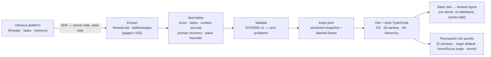

No runtime server, no database: the report is a **static build over a validated JSON snapshot**. The "live" question reduces to "when was the snapshot taken," and the answer ships inside the artifact.

## 6. The loop the report watches (including itself)

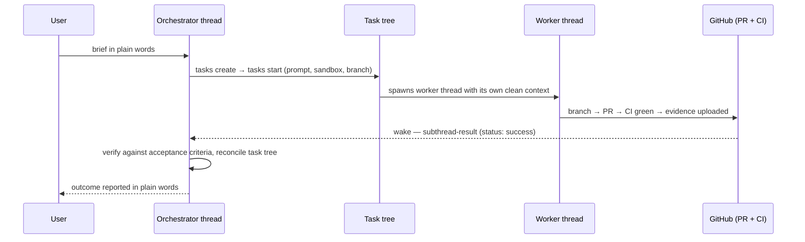

This is the **delegation loop** the Sankey's flow view renders as 43 observed transitions — and the report you are reading was produced *by that very loop*: this document was authored by the orchestrator thread, committed through a worker's PR, and its own tokens are in the table above.

## 7. The seven views — each answers one question

| View | Question it answers | Chart form |
|---|---|---|
| Sankey flow | Where does the work actually go? | Stage-to-stage flow, area-encoded nodes |
| Hierarchy | What happened, in order? | Turn tree (d3-hierarchy), collapsible |
| Context growth | How fast does context fill? | Cumulative lines per thread |
| Delegation | Who was dispatched, to do what? | Task/worker tree |
| Loop model | What *should* happen? | Documented loops, visually distinct from observed data |
| Summary | What are the headline stats? | Metrics + tables |
| Tokens & cost | What did it cost (estimated)? | Turn × agent heatmap + cumulative lines, editable assumed rates |

Six of the seven views share one interaction beyond their charts: a **permanent info panel** beside the content (24rem wide from a 900px container breakpoint). It shows the view's origin by default — the project, the trajectory overview, the root dispatcher, overall totals, grand totals — swaps to the hovered or keyboard-focused mark, and reverts on mouse-out or blur. The content revives what the app's former floating tooltips showed, anchored instead of floating so it is readable with a keyboard or a screen reader; nothing floats, and no tooltip DOM exists.

## 8. Progression — how the main view earned its shape

The Sankey did not start as the panel-driven view above. Eight committed frames show the progression (all in `docs/story/images/`, referenced relatively so they render right here on GitHub):

**v1 — the honest, ugly rectangle Sankey.** Correct data, default `d3-sankey` rectangles.

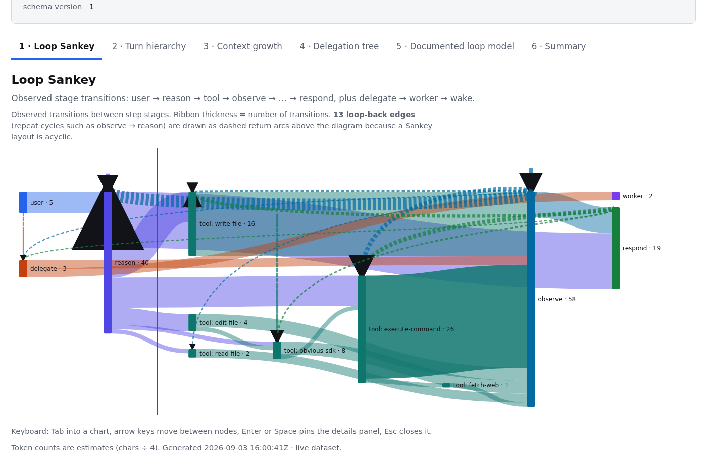

**Reference.** A direction-setting visual the user supplied mid-build.

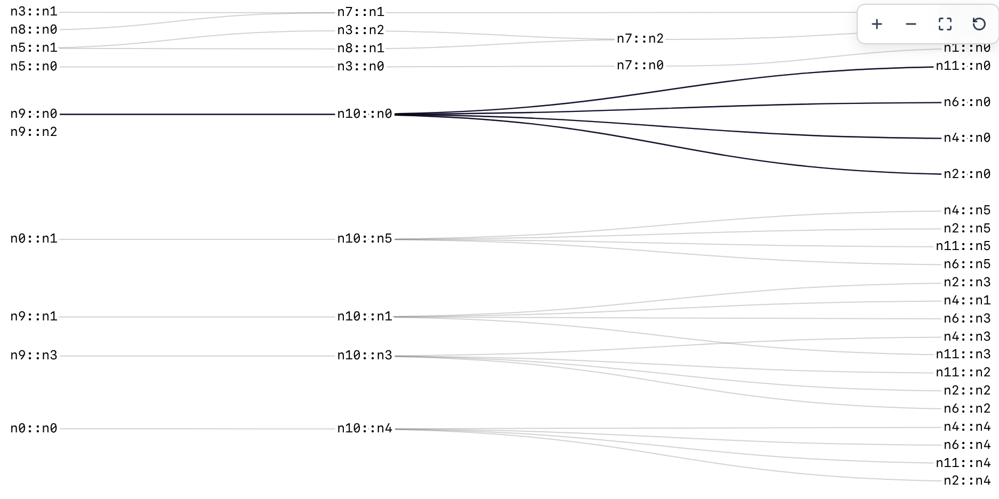

**Dots.** Nodes re-encoded as area-proportional circles (`d3.scaleSqrt`) — the platform's work is *volume*, not width.

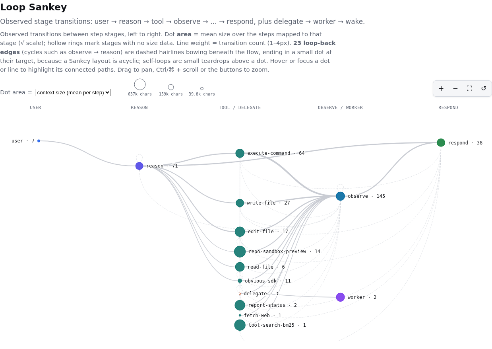

**Prompt toggle.** Context vs. prompt size, switchable per node.

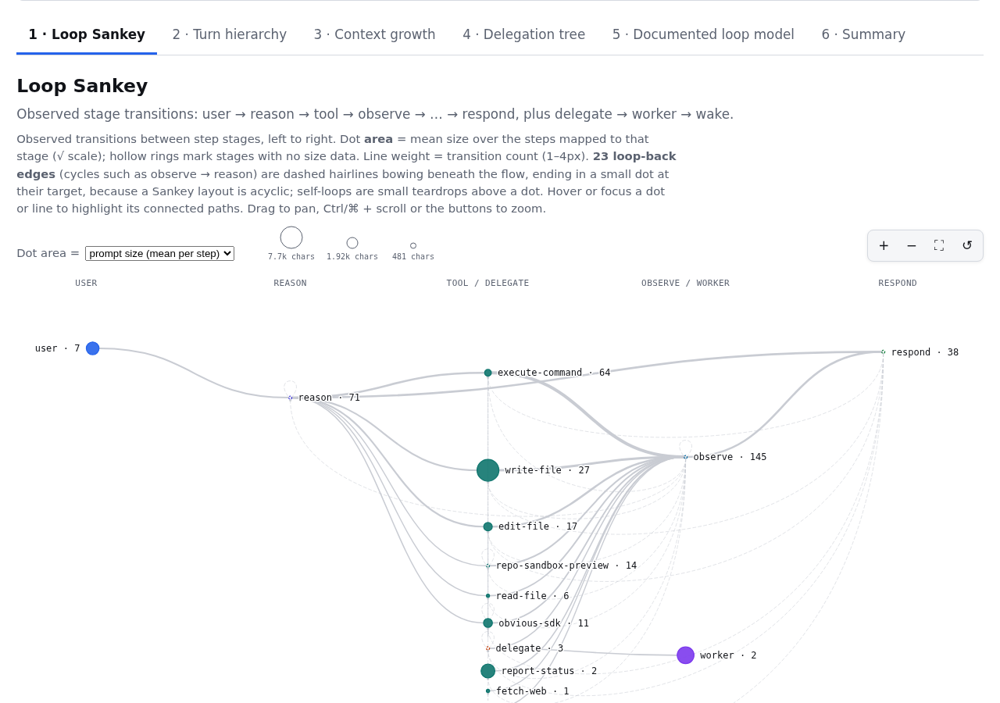

**Hover.** Connected-path highlighting on hover…

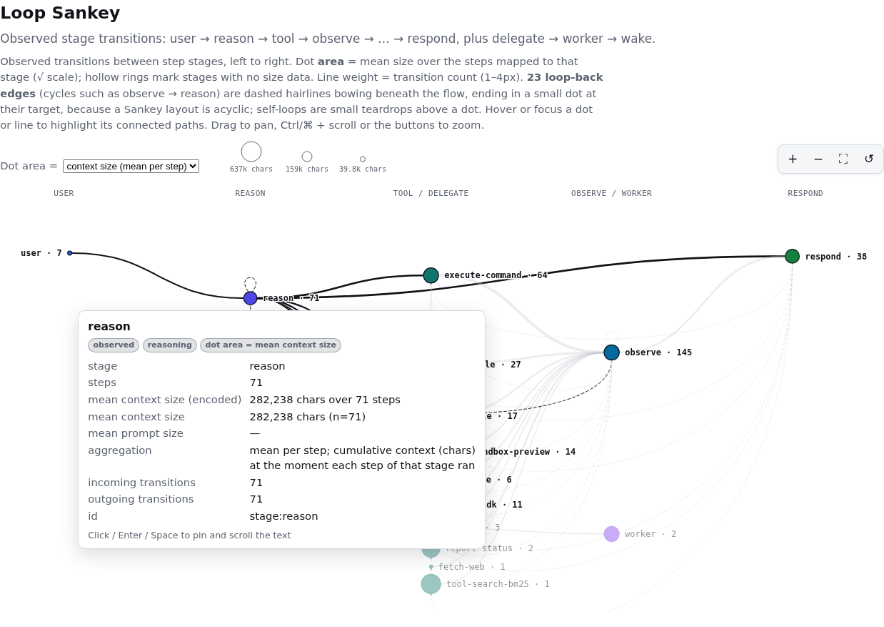

**Dark.** …in both themes, from the start.

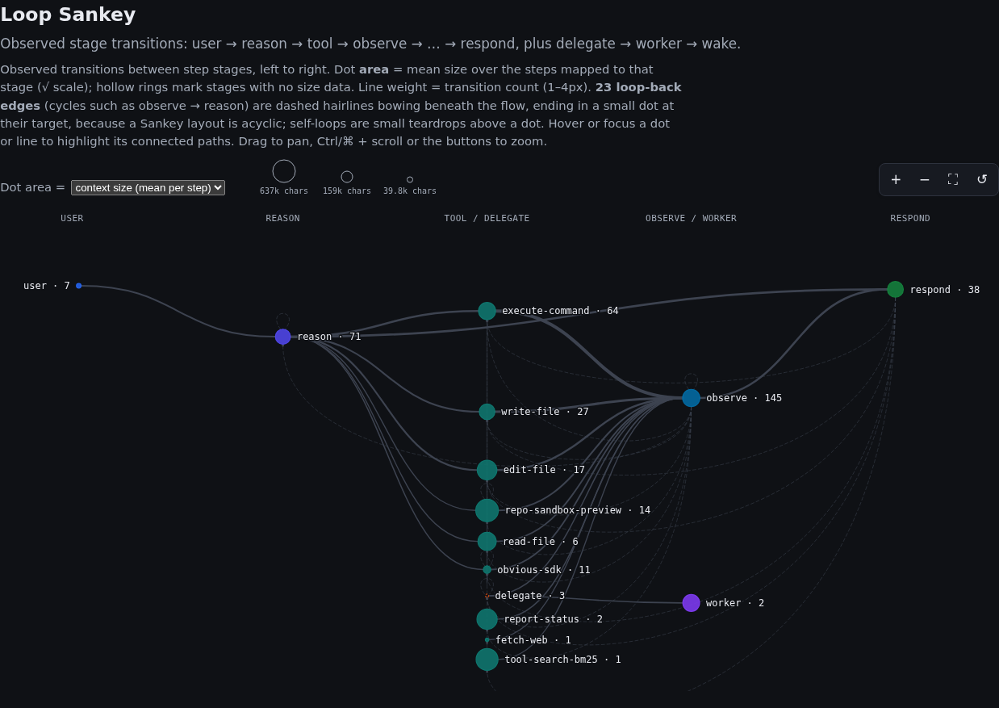

**Anchor tooltips → retired.** The popover-API tooltip pass, later replaced entirely.

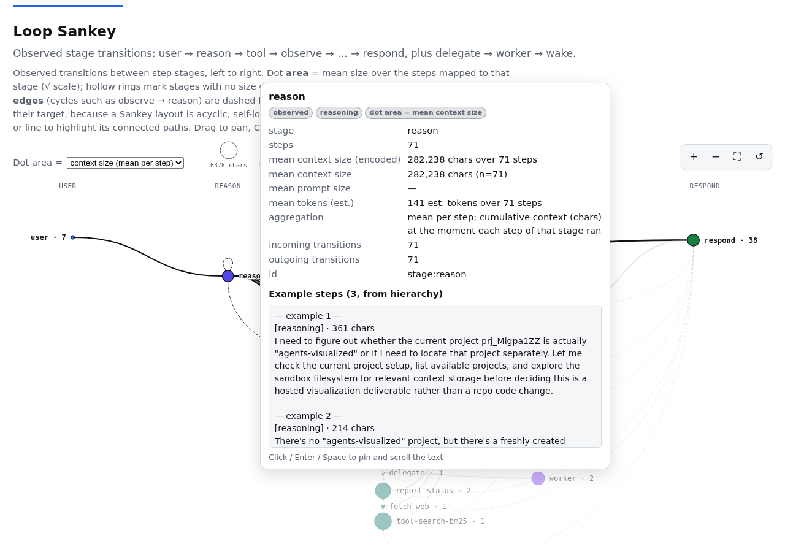

**Static panel, no tooltips.** Floating tooltips retired for good — a permanent, data-derived side panel takes their place.

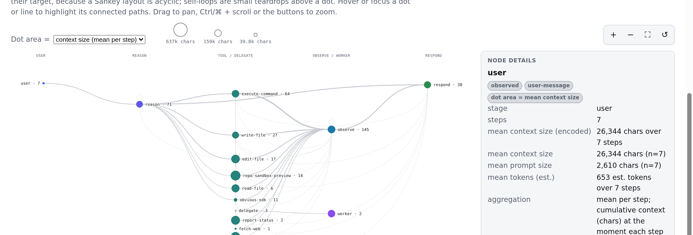

**Today — the permanent panel.** Floating tooltips were removed completely (PR #3): a 24rem data-derived panel now sits beside the chart, defaults to the origin node, and swaps on hover *or keyboard focus* — replacing a pointer-only affordance with one that works for everyone.

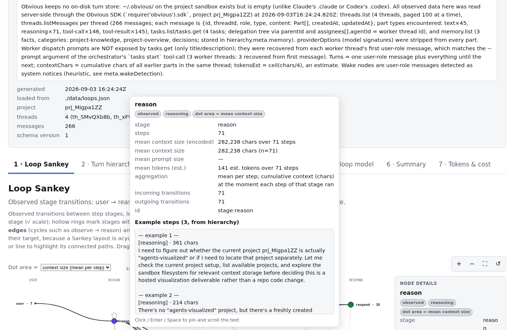

## 9. Honesty by construction

A report about agents is only trustworthy if it refuses to lie about uncertainty:

- **Estimated tokens are estimates.** `ceil(chars/4)`, labeled as such everywhere; the Tokens view's cost model uses *editable, persisted assumed rates* — never presented as provider usage data.
- **Observed ≠ documented.** The `loopModel` block carries `provenance: "documented"` — five idealized loops (turn, delegation, skill, memory, human-in-the-loop) are shown *visually distinct* from the observed flow graph, so the audience never confuses the model with the measurement.
- **Synthetic data can't pass as real.** A labeled fixture (`loops.fixture.json`) renders with a visible banner.
- **Determinism is tested.** Deterministic IDs; a reusable bootstrap extractor re-ran the full thread history producing 1,014 steps with 1,014 unique IDs, and a back-to-back snapshot diff reported **+0 / −0** — same input, same report.

## 10. Verification

- Strict TypeScript, zero `any`; Vite production build committed to the repo.
- Headless QA harness (`qa/qa.mjs`): seven views, zero page/console errors, hover/focus parity, reduced-motion behavior — plus pixel-level screenshot checks in both themes.
- Chrome **Modern Web Guidance**: all 12 applicable guides reviewed; compliance documented in `app/GUIDANCE.md`.
- Every UI change ships with before/after evidence uploaded against the tested commit SHA before merge; CI gates the PR.

## 11. The reusable piece: `agent-loops-report`

The whole pipeline — extraction, digest, optional visualization — is packaged as a workspace skill (`agent-loops-report` v1.0.0) with a committed bootstrap script (`skill/agent-report.cjs`). It supports project/thread/time scopes, snapshot deltas, and the same honesty rules. The report is now a *stage any execution loop can run*, not a one-off.

## 12. Limitations

- **Token estimates, not metered usage.** Chars÷4 ignores tokenizer variance; provider usage APIs are not surfaced through the SDK.
- **One project, one day.** All numbers here are a single project's snapshot (`generatedAt` above); the schema is versioned for comparison, not pooled statistics.
- **No second source of truth.** SDK coverage is the report's floor (see the assumption at the top).
- **Private repo, linked images.** Screens render via relative paths for collaborators viewing on GitHub; raw URLs 404 by design.

## 13. Open questions — what I'd like feedback on

1. **Ground truth:** how would *you* independently verify an agent-activity report against the platform's own accounting?
2. **Token estimation:** is a chars÷4 estimate honest enough to present publicly, or does any estimate without metering mislead more than it informs?
3. **Cost display:** should assumed-rate cost appear at all in a public-facing report, or only in a clearly separated "what-if" mode?
4. **Panel vs. tooltip:** we replaced floating tooltips with a permanent panel (§8) — accessibility win, but it costs screen area. Where is your line?
5. **Loop models:** are visually separating *documented* loops from *observed* loops (§9) enough, or should the documented layer be toggle-off-able to avoid anchoring?

---

*Built by the loop it describes: authored in the orchestrator thread, committed via a worker PR with CI and evidence, and visible live in the hosted report. All numbers from the validated dataset snapshot of 2026-09-03T16:24:24Z.*
