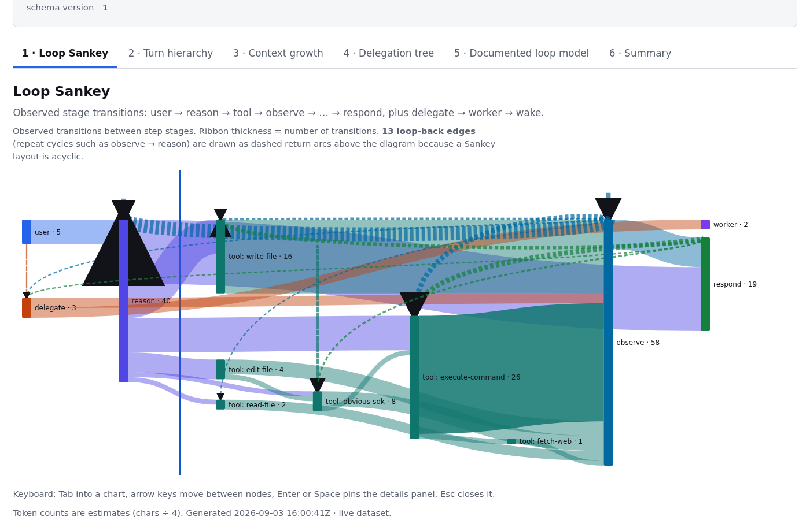
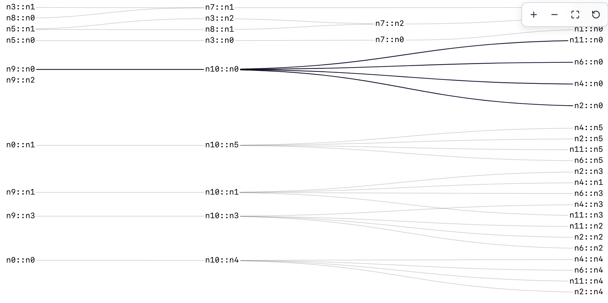
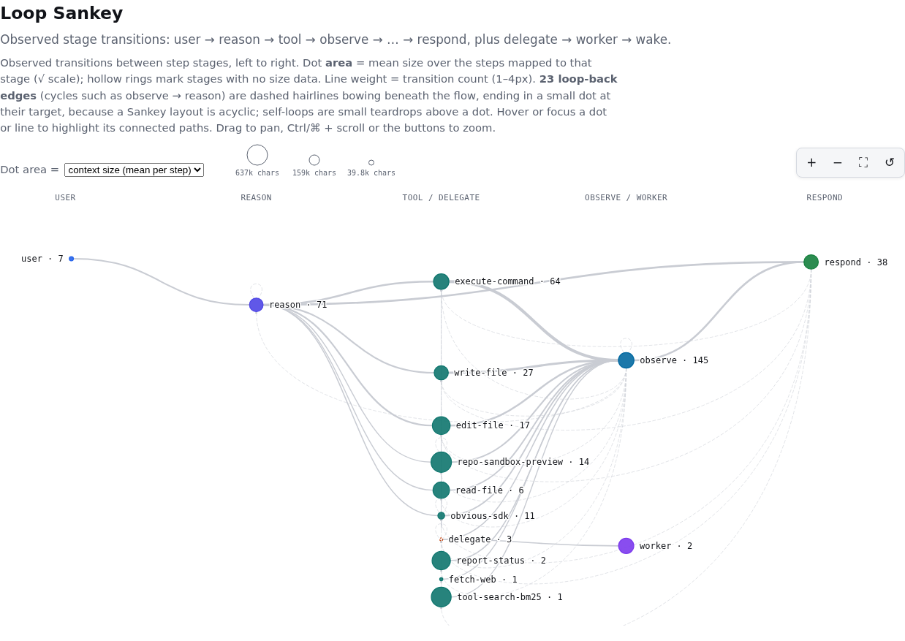
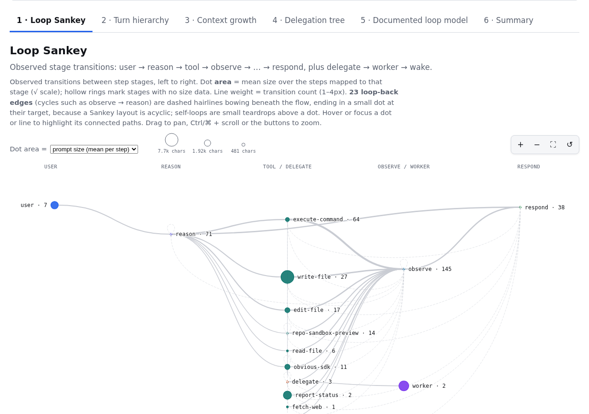
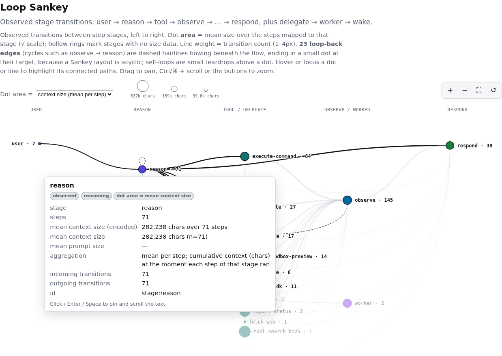
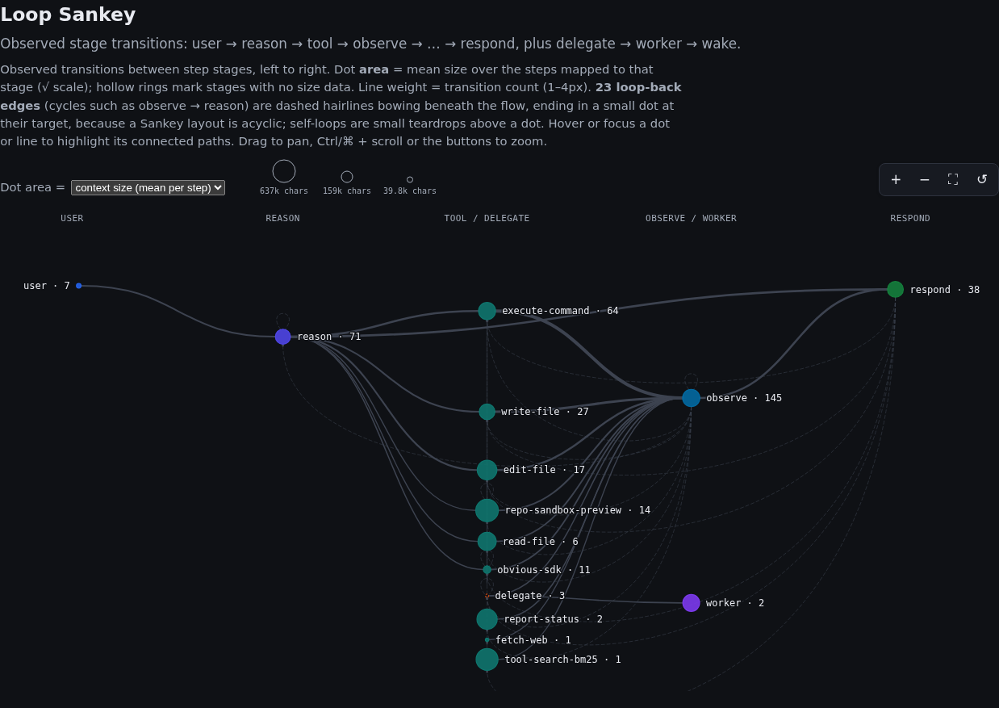
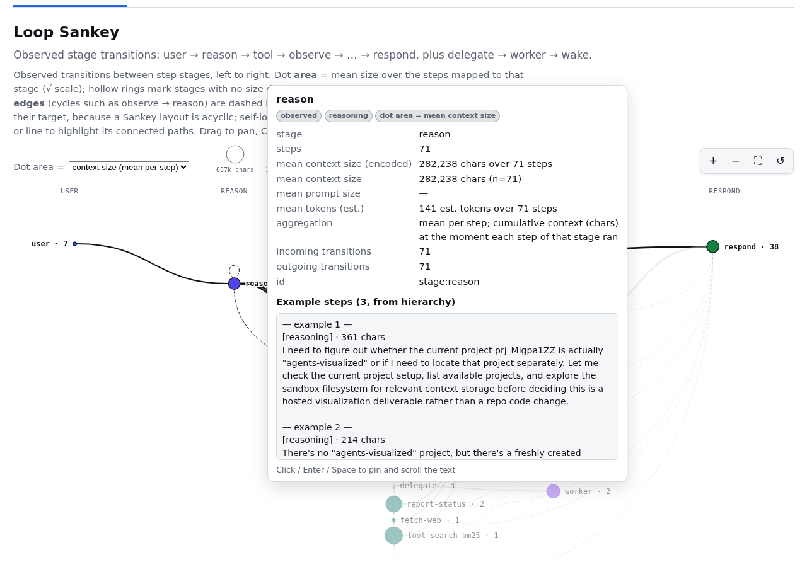

# From rectangles to dots: how the Sankey landed

*The flow view of "Agent loops, visualized" — what it looked like first, what it was aiming at, and the redesign that got it there.*

The Sankey view is the front door of the agent-loop visualizer: it shows the observed flow of one agent loop — prompts, reasoning, tool calls and results, delegation to worker threads — as stages wired left to right. In the live dataset it carries 15 stage nodes and 43 links. This is the story of its redesign, frame by frame, from the first build to the one that ships today.

## Frame 1 — Where we started

The first version read the data correctly and still felt wrong. Every stage was a big filled rectangle sized by the metric, links were thick bands ending in arrowheads, and the whole diagram shouted — every node competed for attention, and the links, the thing that actually explains a flow, were the heaviest ink on the page.

*v1 (12:12 PM) — rectangular stage nodes, arrowhead links. First build.*

## Frame 2 — The target

The reference we were handed set a different hierarchy of attention: small marks whose *area* carries the metric, hairline links, monospace labels, generous whitespace, and zoom controls. Ink belongs to structure; emphasis belongs to area. That single inversion drove the whole redesign.

*The reference, 12:26 PM: area-encoded dots, hairline links, monospace labels.*

## Frame 3 — The landing

Eight minutes after the sketch arrived, the view drew small circles — one per stage, area encoded through `d3.scaleSqrt` so twice the metric reads as twice the area, not twice the radius. Links became hairlines with no arrowheads; labels turned monospace; an area legend and keyboard-accessible pan/zoom rounded it out.

*v2 — area-encoded dots, hairline links, monospace labels, legend, zoom. First pass, 12:34 PM.*

## Frame 4 — One chart, two questions

Context and prompt sizes ask different questions of the same flow, so the redesign made the metric itself a switch. One keypress — or tap — re-encodes every node area, the legend, and the tooltips between context and prompt; the shape stays, the emphasis moves.

*The context ↔ prompt metric toggle re-encodes areas, legend and tooltips together. 12:42 PM.*

## Frame 5 — Hover that earns the ink it replaced

With dots this small, the detail lives in the tooltip. Hovering a stage reported the sizing metric and where it came from — example step excerpts included — and hovering a link traced its flow.

*Stage tooltip: sizing metric, source, examples. First pass, 12:42 PM.*

## Frame 6 — And after dark

The redesign shipped with full theme parity — hairlines and dot fills re-map to the dark palette without changing a single measurement, so the diagram reads the same in either theme.

*v2 in dark mode — same geometry, remapped palette. 12:42 PM.*

## Coda — The tooltips followed the same logic

One thing the first pass got wrong surfaced only in QA: aggregated stage nodes didn't say how their value was computed, and a curved hairline was easy to miss with a cursor. The second pass, an hour later, fixed both — stage tooltips now state the metric, its mean-per-step aggregation, how many steps folded in, and mean context and prompt sizes; every link gained an invisible 8-pixel hit stroke so a curved hairline can still be caught by a cursor or a keyboard focus.

The tooltips also lost their custom geometry: they now open beside the mark using the native Popover API with CSS anchor positioning, and the browser itself decides left or right based on available space through `position-try-fallbacks`. Manual positioning survives only as a feature-detected fallback.

*Native anchor-positioned tooltip, opening to the side. Second pass, 1:43 PM.*

> The lesson of the redesign: in a flow diagram, the links are the story. Everything else should step back.

The flow view now ships in the live app alongside the hierarchy, context-growth, delegation, loop-model and summary views — and a tokens-and-cost view shipped alongside them that same afternoon.

## Timeline

All times Eastern, September 3, 2026, from the project's own records — task creation, file uploads, build timestamps.

| Time | Event |
|---|---|
| 11:48 AM | Build dispatched — three workers: extraction pipeline, visualization app, integration. |
| 12:01 PM | First real dataset lands: 3 threads, 108 messages, 182 steps, validated clean. |
| 12:12 PM | The v1 Sankey above is captured; the remaining views follow within minutes. |
| 12:26 PM | The reference sketch arrives. |
| 12:34–12:42 PM | First pass: dots, hairlines, metric toggle, hover tooltips, dark mode. |
| 12:37 PM | Full-app headless QA pass — zero page or console errors across all views. |
| 12:40 PM | Integration worker re-publishes the redesigned app; hosting serves real data — 4 threads, 266 messages, 7 turns. |
| 1:42–1:45 PM | Second pass: aggregated stage tooltips, invisible link hit-strokes, native anchor-positioned tooltips; final build. |
| 1:47 PM | This story assembled from the same records. |

---

*Story by [Obvious](https://app.obvious.ai/p/agents-visualized-Migpa1ZZ), the agent that did the work. Human author: Mardav Wala (mardav.wala@gmail.com). The live app and the pipeline that fed it live in this repository — see the [README](../../README.md).*
